# full

Rendered from the sample in `.trmnlp.yml` by `trmnl-plugin/screenshots.sh`.
Each image is the whole screen at the panel's pixel size; the half and
quadrant layouts sit in the mashup frame the device would draw.

## TRMNL OG (1-bit)

### landscape, light

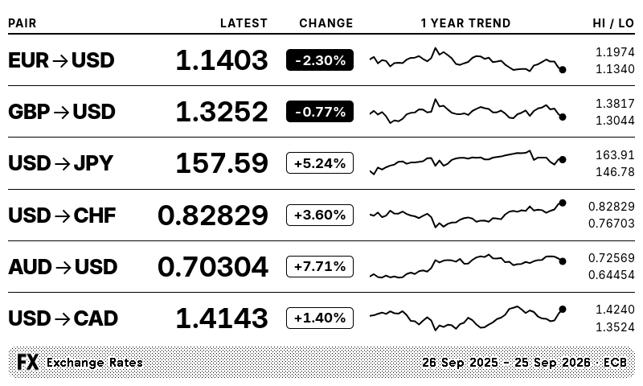

### landscape, dark

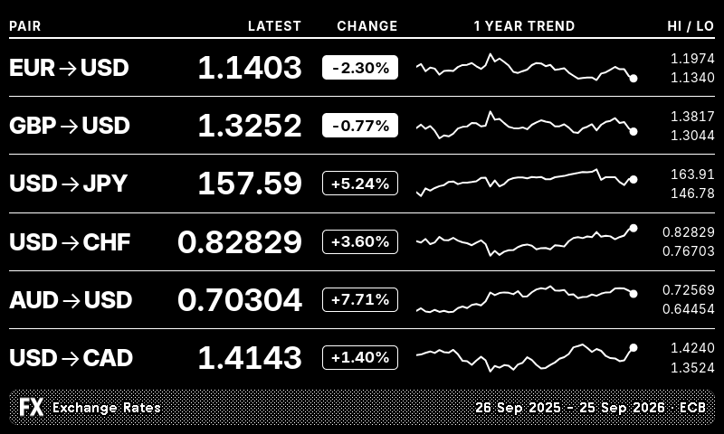

### portrait, light

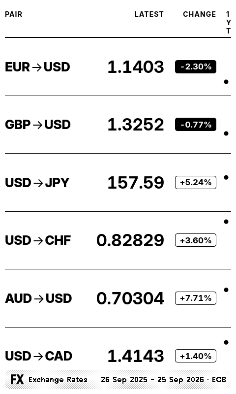

### portrait, dark

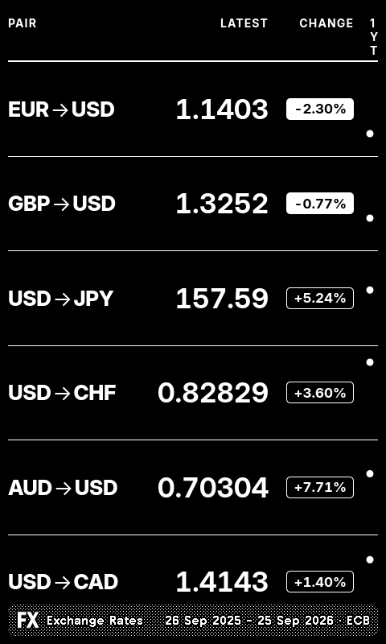

## TRMNL OG (2-bit)

### landscape, light

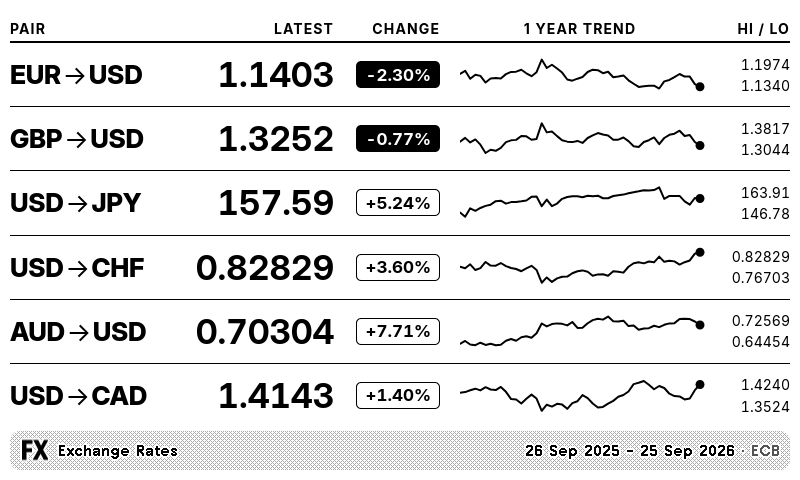

### landscape, dark

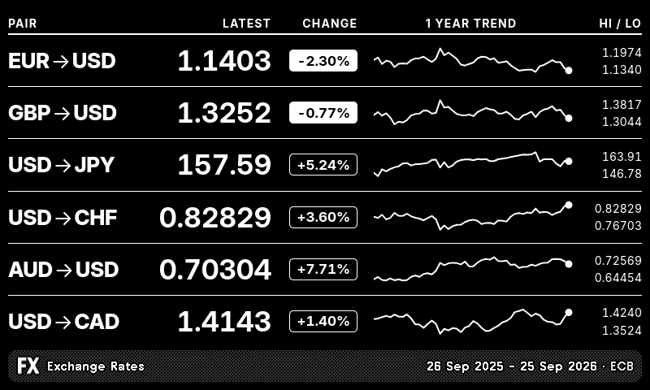

### portrait, light

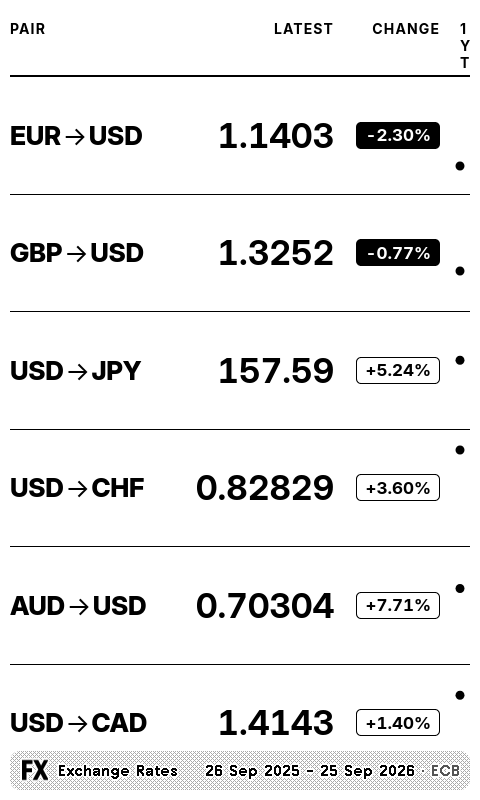

### portrait, dark

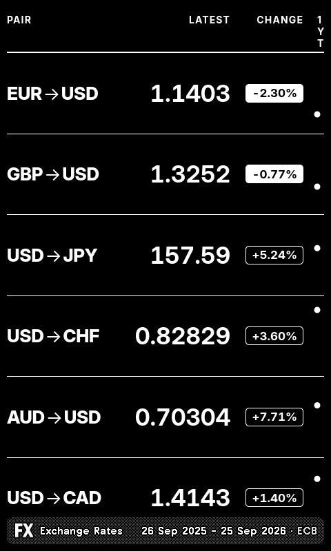

## TRMNL X (4-bit)

### landscape, light

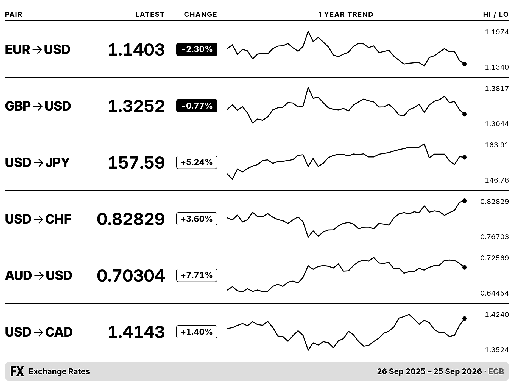

### landscape, dark

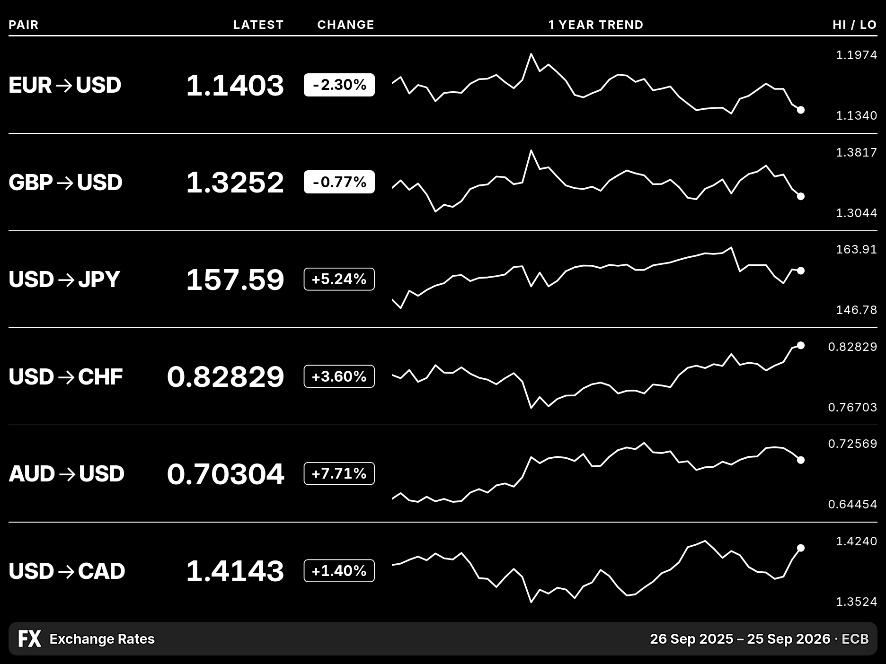

### portrait, light

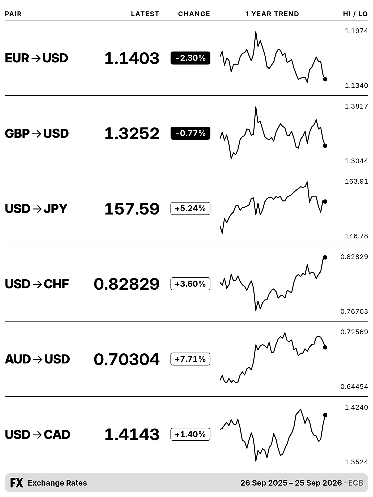

### portrait, dark

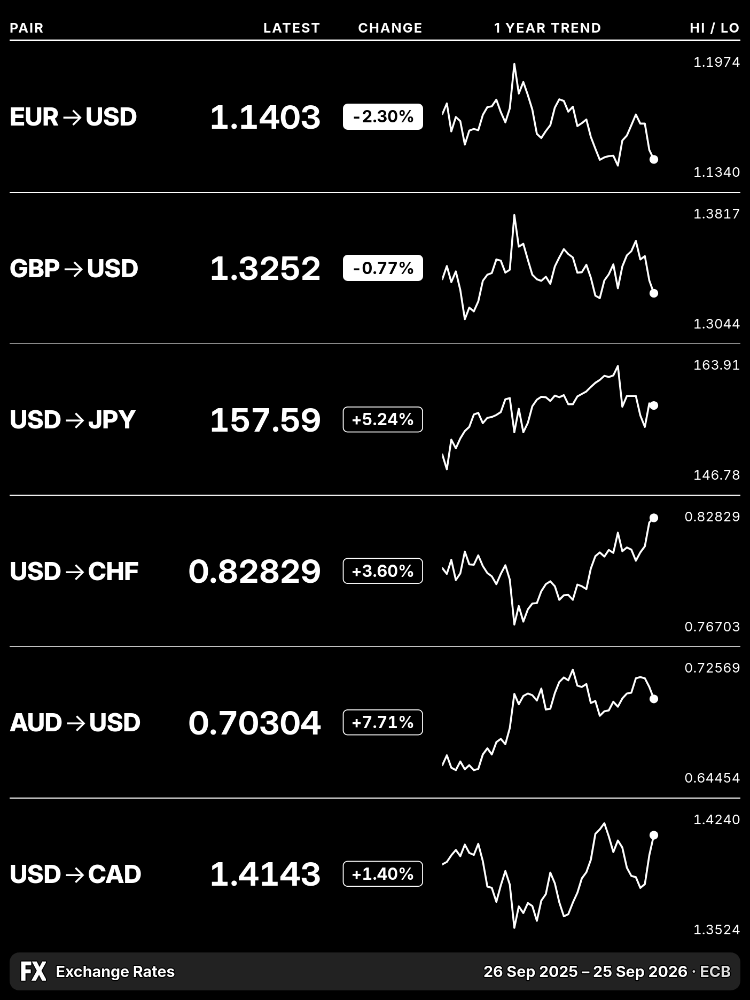

